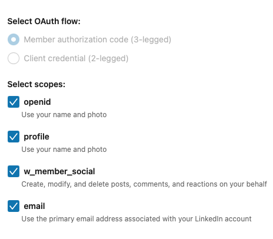

# LinkedSky: Post to LinkedIn and Bluesky programmatically
When X was still Twitter it offered a public API. That made it possible to create a post on LinkedIn and configure
LinkedIn to also post the same content to Twitter. This is not possible anymore, so I've decided to move to Bluesky and
write a program that supports posting to both platforms using their APIs.

## LinkedIn integration
Getting access to LinkedIn's API is a bit tricky. First, you need to create a new company page and verify it. Then,
you have to [create an app](https://www.linkedin.com/developers/apps?appStatus=active) that belongs to the specific 
company. You can use the app to create long-lived tokens for accessing the REST API.

**Note**: When [generating a token](https://www.linkedin.com/developers/tools/oauth/token-generator), make sure to 
give it all available OAuth 2.0 scopes, as shown below . Also, Safari doesn't work well with this process, I'm using Firefox to do it.

Once you have a token, you can use it to interact with the REST API. Execute a `GET` request on 
https://api.linkedin.com/v2/userinfo using the same token you will publish with. Set `LINKEDIN_AUTHOR` to
`urn:li:person:<sub>` using the exact `sub` value returned for that token. Publishing to a personal profile requires
`w_member_social`. [LinkedIn Posts API](https://learn.microsoft.com/en-us/linkedin/marketing/community-management/shares/posts-api)

### References
[LinkedIn API access documentation](https://www.linkedin.com/help/linkedin/answer/a526048/accessing-linkedin-apis?lang=en)

## Bluesky integration
To use the Bluesky API all you need is an account. You can use your account's credentials to receive access tokens, but
this part is conveniently managed by the SDK, when using it.

### References
[Bluesky SDK documentation](https://docs.bsky.app/docs/get-started)

## Usage
Use Python 3.15 to create a virtual environment and install the dependencies.
```bash
python3.15 -m venv linkedskyenv
source linkedskyenv/bin/activate
python -m pip install -r requirements.txt
```

If you don’t already have a `.env` file, copy the example and replace the placeholders with your own values.
```bash
cp .env.example .env
```

### Web UI

Start the local web composer and open `http://127.0.0.1:8765` in your browser.

```bash
python linkedsky_web.py
```

Enter the post text and article details, choose LinkedIn, Bluesky, or both, then publish. The composer shows the result for each platform and enables a platform when its credentials are set in `.env`. If port 8765 is in use, run `python linkedsky_web.py --port 8766` and open the address printed by the server.

### Terminal

Run `python linkedsky.py` to use the interactive terminal prompts.

### Post length limits

Post text includes hashtags and the spaces added before them. The Web UI shows live counts, and both the Web UI and terminal check the selected platforms before sending a post.

- LinkedIn allows up to 3,000 characters in post text and 8,192 characters in the article URL. [LinkedIn UGC Post API](https://learn.microsoft.com/en-us/linkedin/compliance/integrations/shares/ugc-post-api)
- Bluesky allows up to 300 visible characters (grapheme clusters) and 3,000 UTF-8 bytes in post text. Each hashtag can contain up to 64 grapheme clusters and 640 bytes, excluding `#`. Article URLs can contain up to 8,192 bytes. [Post schema](https://github.com/bluesky-social/atproto/blob/main/lexicons/app/bsky/feed/post.json) · [Hashtag schema](https://github.com/bluesky-social/atproto/blob/main/lexicons/app/bsky/richtext/facet.json) · [AT Protocol Lexicon](https://atproto.com/specs/lexicon)

## Tests

With the dependencies installed, run the unit tests from the project directory.

```bash
python -m unittest discover -v
```
